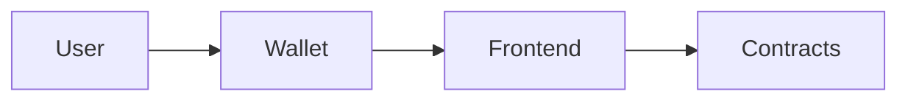

# Project Name

One-line description of the user outcome.

[Live demo](https://example.com) · [Demo video](https://example.com) · [Contracts](#contracts)

## Problem

One user, one painful moment, one concrete number.

## Solution

What the product does and why the blockchain is required.

## How it works



## Contracts

| Network | Contract | Address |
|---|---|---|
| Base Sepolia | | |

## Sponsor integrations

- Sponsor:
- What it does:
- Proof:

## Run locally

```bash
git clone <repo>
cd <repo>
cp .env.example .env
forge install
forge test
forge script script/Deploy.s.sol:Deploy --rpc-url $TESTNET_RPC_URL --account deployer --broadcast
```

## Tests

```bash
forge test -vvv
```

## Team

- Name, role, link.

## AI usage

See [AI_USAGE.md](AI_USAGE.md).

## License

MIT
