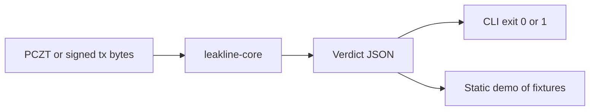

# Architecture

Leakline bir Zcash işlemini yayınlanmadan okur. Yeni bir işlem kurmaz, ağa göndermez, anahtar tutmaz.

## Diagram

## Components

| Component | Responsibility | Chain |
|---|---|---|
| `leakline-core` | Baytları çözümler, politika uygular, kod üretir | Yok. Yerel |
| `leakline` CLI | Dosya veya stdin okur, tek satır JSON basar | Yok |
| `fixtures/` | Kazınmış işlemler ve beklenen kararlar | Zcash mainnet veya testnet, sadece okuma |
| Demo sayfası | Aynı kütüphaneyi tarayıcıda, veya CLI kaydı | Ağ çağrısı yok |

## Contracts

Yok. Zcash'te bu ürün için sözleşme yok.

## Trust assumptions

- Araç konsensüs alanlarını okur. Global anonimlik iddia etmez.
- Sunucu yoktur. İşlemi barındıran sayfa, işlemi öğrenir. Demo ya tarayıcıdadır ya da önceden konmuş örnekleri gösterir.
- Explorer linki yazdırılır, araç o adresi açmaz.
- `librustzcash` çözümleyicisine güvenilir. El yazması ayrıştırıcı yok.

## Data flow

1. Çağıran bir `.pczt` veya ham işlem hex'i verir. İsteğe bağlı `--policy FullPrivacy`.
2. Kütüphane sürümü tanır. v4, v5 ve v6 okunur. Bunların dışı, ya da tanınmayan demet, `LEAK` / `UNRECOGNIZED`.
3. Transparent girdi, transparent çıktı ve shielded bakiyeler okunur.
4. İki shielded havuzun bakiyesi tutarı düz metin gösteriyorsa `LEAK` / `POOL_CROSSING`.
5. Seçilen politika bu açıklamaya izin veriyorsa sonuç `CLEAN` olabilir. Varsayılan `FullPrivacy` izin vermez.
6. JSON ve çıkış kodu döner.

## Failure modes

| Failure | User impact | Handling |
|---|---|---|
| Bozuk hex | Karar yok | Çıkış 2, kullanım hatası |
| Bilinmeyen sürüm | Yanlış `CLEAN` riski | `LEAK`, gerekçe `UNRECOGNIZED` |
| Ham işlemde girdi tutarı yok | Tutar uydurulursa yalan olur | Tutar basılmaz. Yön, bakiye işaretinden söylenir |
| WASM derlenemez | Tarayıcı demo gecikir | CLI ve örnek dosyalar yeterli sayılır |
| PCZT içinde açık metadata | Paylaşılırsa cüzdan yapısı sızar | Paylaşmadan önce uyarı. Araç metadata'yı bir yere yollamaz |

## Deployed addresses

Yok.
