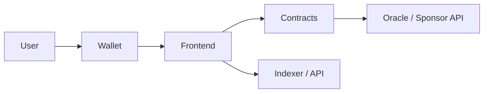

# Architecture

## Diagram

## Components

| Component | Responsibility | Chain |
|---|---|---|
| | | |

## Contracts

| Contract | Purpose | Key functions | Access |
|---|---|---|---|
| | | | |

## Trust assumptions

- Admin:
- Upgradeability:
- Oracle:
- External calls:

## Data flow

1.
2.
3.

## Failure modes

| Failure | User impact | Handling |
|---|---|---|
| RPC down | | |
| Transaction reverts | | |
| Oracle stale | | |
| Wrong network | | |

## Deployed addresses

| Network | Contract | Address | Explorer |
|---|---|---|---|
| | | | |
